# Prediksi Konsumsi Energi Menggunakan Hybrid Fuzzy Time Series dan Machine Learning dengan Pendekatan Explainable Artificial Intelligence

Repository ini berisi eksperimen penelitian prediksi konsumsi energi rumah tangga untuk horizon **H1-H24**. Data 10 menit dari UCI Appliances Energy Prediction diagregasi menjadi konsumsi energi per jam dalam kWh, lalu model menghasilkan 24 prediksi jam ke depan dan total konsumsi energi 24 jam.

Metode yang didokumentasikan sebagai kandidat hybrid utama adalah **Hybrid Weighted Fuzzy Time Series-Residual Random Forest**, khususnya konfigurasi **Weighted FTS order 3 + Random Forest residual** dari Stage 7. Audit Stage 7.1 menunjukkan konfigurasi ini memiliki Daily MAE test **3.0977 kWh**, tetapi validation Daily MAE **5.7880 kWh**, sehingga hasilnya harus dibaca sebagai **test-best eksploratif**, bukan bukti bahwa model tersebut paling stabil.

## Ringkasan penelitian

Masalah penelitian adalah memperkirakan konsumsi energi peralatan listrik rumah untuk 24 jam ke depan. Weighted FTS digunakan untuk menangkap pola transisi konsumsi dalam bentuk state fuzzy. Random Forest residual digunakan untuk mempelajari sisa kesalahan FTS, sehingga prediksi akhir dihitung sebagai:

```text
Prediksi akhir = Prediksi Weighted FTS + Prediksi residual Random Forest
```

SHAP digunakan pada Stage 6 untuk menjelaskan model XGBoost Direct. **SHAP khusus Random Forest residual belum tersedia**, sehingga repository tidak mengklaim grafik SHAP XGBoost sebagai SHAP Random Forest.

## Dataset

- Sumber: UCI Appliances Energy Prediction Dataset.
- File mentah: `energydata_complete.csv`.
- Target awal: `Appliances` dalam Wh pada interval 10 menit.
- Preprocessing: enam pencatatan 10 menit dijumlahkan menjadi satu jam, lalu dibagi 1000 menjadi kWh.
- Dataset hourly lengkap: **3.289 observasi**.
- Split kronologis: train 70%, validation 15%, test 15%.
- Evaluasi H1-H24 memakai 20 forecast origin non-overlap pada test.

## Alur metodologi

```mermaid
flowchart LR
    A[Data 10 menit] --> B[Preprocessing hourly kWh]
    B --> C[Quantile 15 interval]
    C --> D[Weighted FTS order 3]
    D --> E[Prediksi awal FTS H1-H24]
    E --> F[Residual aktual - FTS]
    F --> G[Random Forest residual]
    G --> H[Prediksi akhir H1-H24]
    H --> I[Total energi 24 jam]
    I --> J[Evaluasi MAE/RMSE/MAPE]
    J --> K[Audit + XAI]
```



## Hasil eksperimen utama

### Kandidat hybrid FTS3-Random Forest residual

| Split | Daily MAE | Hourly MAE | Catatan |
|---|---:|---:|---|
| Validation | 5.7880 kWh | tidak dipakai sebagai klaim utama | Buruk pada validation |
| Test | 3.0977 kWh | 0.2611 kWh | Test-best eksploratif |

### Pembanding Direct ML terbaik pada test

| Model | Daily MAE test | Hourly MAE test |
|---|---:|---:|
| LightGBM Direct | 3.1397 kWh | 0.2120 kWh |

### Model terbaik berdasarkan validation dari audit Stage 7.1

| Model | Validation Daily MAE | Test Daily MAE |
|---|---:|---:|
| Hybrid FTS2-SVR Validation threshold | 1.9604 kWh | 4.4689 kWh |

Audit Stage 7.1 memberi verdict **PASS WITH LIMITATIONS**. Rekomendasi penelitian yang paling aman adalah menampilkan **Direct ML sebagai baseline utama**, sedangkan hybrid FTS-ML sebagai analisis eksploratif yang belum terbukti stabil/signifikan.

## Visualisasi penting

- Konsumsi historis: `figures/hourly_energy_time_series.png`
- Distribusi target: `figures/target_distribution.png`
- Fuzzy state counts: `figures/fuzzy_state_counts.png`
- Error horizon: `figures/stage7/stage7_05_horizon_mae.png`
- Aktual vs prediksi H1-H24: `figures/stage7/stage7_06_actual_vs_prediction_24h.png`
- Audit residual RF: `results/stage7_1_audit/figures/residual_fts3_rf_scatter_daily.png`

## Struktur repository

```text
data/       Dataset hourly hasil preprocessing.
notebooks/  Notebook walkthrough dan notebook pendukung.
src/        Pipeline eksperimen Stage 1-7.1.
configs/    Konfigurasi eksperimen.
results/    CSV hasil evaluasi, prediksi, dan audit.
figures/    Grafik penelitian.
reports/    Laporan eksperimen per stage.
docs/       Dokumentasi metodologi dan audit repository.
tests/      Regression tests ringan.
```

## Instalasi

```bash
python -m venv .venv
.venv\Scripts\activate
pip install -r requirements.txt
```

## Penggunaan

Jalankan dari root repository.

```bash
python run_preliminary.py
python run_stage2.py
python run_stage3.py
python run_stage4.py
python run_stage5.py
python run_stage6.py
python run_stage6_audit.py
python run_stage7.py
python run_stage7_1_audit.py
python run_stage7_1_full_audit.py
```

Untuk membuka panduan penelitian:

```bash
jupyter notebook notebooks/00_complete_research_walkthrough.ipynb
```

Untuk menjalankan perbandingan Random Forest dan Weighted FTS dari artifact yang sudah tersedia tanpa training ulang:

```bash
jupyter notebook notebooks/08_random_forest_fts_comparison.ipynb
```

Catatan: Stage 7 melatih banyak model per horizon dan bisa memakan waktu lama. Untuk membaca hasil tanpa training ulang, buka notebook utama yang memakai artefak CSV yang sudah tersedia.

## Testing

```bash
python -m py_compile src/stage2_pipeline.py src/stage3_pipeline.py src/stage7_pipeline.py
pytest tests
```

## Keterbatasan

- Dataset berasal dari satu rumah.
- Test Stage 7 bukan holdout baru sepenuhnya karena periode tersebut sudah dianalisis pada Stage 1-6.
- Residual FTS3-RandomForest bagus pada test tetapi buruk pada validation.
- Hybrid threshold belum terbukti memberi peningkatan stabil/signifikan.
- SHAP Random Forest residual belum tersedia; SHAP yang tersedia saat ini adalah untuk XGBoost Direct pada Stage 6.

## Stage 8: benchmark 10 menit berbasis paper

Stage 8 tersedia di `results/stage8_paper_benchmark/` dan memakai target `Appliances` pada resolusi asli 10 menit. Track A adalah approximate reproduction terhadap Candanedo et al. (2017), sedangkan Track B adalah evaluasi kronologis rolling one-step yang menjadi benchmark utama. Jalankan dengan `python run_stage8.py`; paket hasil lokal dibuat sebagai `stage8_paper_benchmark.zip`. Hasil Stage 8 tidak menimpa Stage 1-7.1.

## Stage 9: benchmark ARIMA dan SARIMA hourly

Stage 9 menambahkan ARIMA dan SARIMA pada jalur evaluasi hourly Stage 1-7 dengan origin H1-H24 yang sama. Model dipilih dari validation Daily MAE, kemudian hasil test dimasukkan ke katalog `results/stage9_arima_sarima/ALL_HOURLY_MODELS.csv` dan ranking gabungan `HOURLY_MODEL_RANKING.csv`. Jalankan dengan `python run_stage9.py`; paket hasil dibuat sebagai `stage9_arima_sarima_package.zip`. Stage 8 tetap dipisahkan karena memakai resolusi 10 menit dan satuan Wh.

## Referensi

- UCI Machine Learning Repository: Appliances Energy Prediction Dataset.
- Fuzzy Time Series: konsep universe of discourse, interval, fuzzy logical relationship, dan weighted transition.
- Random Forest Regressor dari scikit-learn.
- SHAP untuk explainable AI pada model tree-based.
